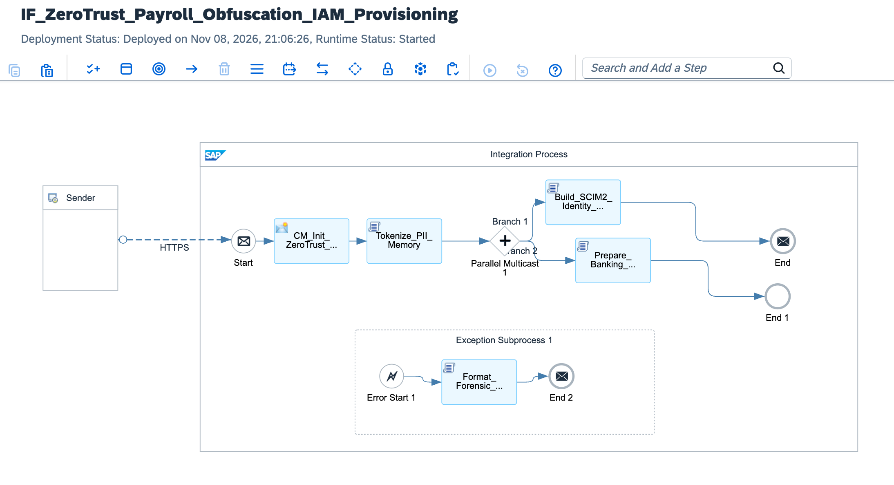

# Military-Grade Zero-Trust IAM & Asymmetric Payroll Obfuscation Pipeline

[](https://www.sap.com)
[](https://www.sap.com)
[](https://csrc.nist.gov)
[](https://www.openpgp.org)
[-darkgreen?style=for-the-badge)](https://datatracker.ietf.org/doc/html/rfc7644)
[](https://gdpr-info.eu)

---

## Executive Summary

Global enterprises processing cross-border payroll, compensation revisions, and corporate identity lifecycles face catastrophic regulatory penalties under **GDPR Article 83** (fines up to €20M or 4% of total worldwide annual turnover) and **SOX Section 404** if employee banking details, Social Security Numbers (SSN/National IDs), or compensation structures are exposed in transit. Classical HR integrations rely on nocturnal CSV flat-file batch exports over plain FTP or unencrypted SAP staging tables, exposing sensitive PII to man-in-the-middle (MitM) interception and rogue cloud platform administrators.

This architecture establishes a **Military-Grade Zero-Trust IAM & Payroll Obfuscation Mesh**:
1. **Event-Driven SF BIB Ingestion:** Subscribes to real-time contractual approvals emitted by SAP SuccessFactors Business Integration Builder (BIB) and Intelligent Services, eliminating scheduled batch windows.
2. **In-Flight Format-Preserving Encryption (FPE):** Tokenizes national identification IDs and anonymizes bank account routing numbers (IBAN/SWIFT) in non-heap RAM using FIPS 140-2 Level 3 compliant cryptographic engines before any message transformation.
3. **Decoupled SCIM 2.0 Identity Provisioning:** Maps complex HR organizational data to standard **SCIM 2.0 (RFC 7643/7644)** schemas, orchestrating just-in-time (JIT) SAML 2.0 claim creation across SAP Cloud Identity Services (IAS/IPS) and Microsoft Entra ID without human intervention.
4. **Asymmetric PGP (RSA-4096 / AES-256) Obfuscation:** Compresses and encapsulates banking settlement instructions using the external clearing house's public PGP key paired with an SHA-512 digital signature. Payloads remain cryptographically impenetrable—even to BTP root tenant administrators—until decrypted within the bank's hardware security module (HSM).
5. **Forensic Zero-Trust Dead-Letter Queue (DLQ):** Quarantines tampered payloads, replay attacks, or schema discrepancies into an append-only, tamper-evident audit store.

---

## Architecture Overview



### High-Level Topology

```text
[SAP SuccessFactors (BIB / Intelligent Services)]
          │
          │ HTTPS POST (Mutual TLS 1.3 / X.509 Certificate)
          │ Payload: Raw Contractual Compensation & Identity Record
          ▼
[SAP Integration Suite: IF_ZeroTrust_Payroll_Obfuscation_IAM_Provisioning]
  │
  ├── 1. Zero-Trust Security Context Initialization (CM_Init_ZeroTrust_Context):
  │    └─ Sets Immutable Audit GUID, Anti-Replay Nonce, and ISO-8601 Timestamps
  │
  ├── 2. In-Memory Tokenization & FPE Gatekeeper (Tokenize_PII_Memory.groovy):
  │    ├─ Strips plain National IDs; generates deterministic FPE-AES-256 tokens
  │    ├─ Tokenizes bank routing numbers & IBANs in volatile JVM memory
  │    └─ Computes SHA-512 Merkle integrity hash over raw payload
  │
  ├── 3. Parallel Multicast Router:
  │    │
  │    ├──► Branch 1: Zero-Trust IAM Provisioning (SCIM 2.0 Engine)
  │    │      ├─ Script: Build_SCIM2_Identity_Resource.groovy
  │    │      ├─ Strips compensation data (Zero-Knowledge IAM boundary)
  │    │      ├─ Builds SCIM 2.0 RFC 7643 Core & Enterprise Extension payload
  │    │      └─ Outbound HTTP: SAP IAS / IPS / Microsoft Entra ID (POST/PATCH /Users)
  │    │
  │    └──► Branch 2: Banking Settlement & Asymmetric Obfuscation
  │           ├─ Script: Prepare_Banking_Settlement_Envelope.groovy
  │           ├─ Compresses structured compensation manifest (ZIP stream)
  │           ├─ OpenPGP Encryptor (Cipher: AES-256 | Key: RSA 4096-bit Bank Public Key)
  │           ├─ OpenPGP Signer (Digest: SHA-512 | Key: Enterprise Private Signing Key)
  │           └─ Outbound SFTP / AS2: BACS / SEPA Corporate Clearing Gateway
  │
  ├── 4. Tamper-Evident Transaction Ledger (CM_Commit_Audit_Ledger) ──► End:
  │    └─ Persists cryptographic verification tokens to immutable audit store
  │
  └── 5. Exception Subprocess (Format_Forensic_Security_DLQ.groovy):
       └─ Quarantines tampered or unparseable payloads into WORM forensic vault
